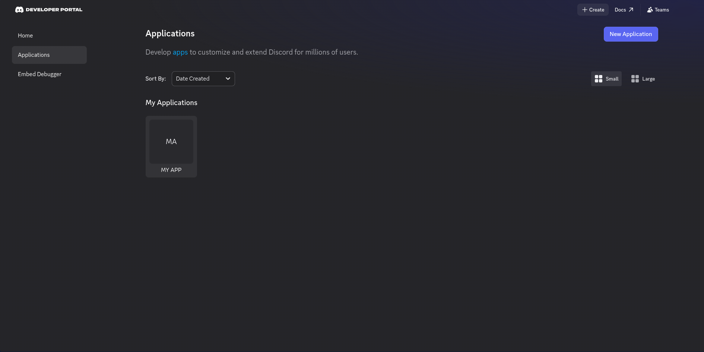
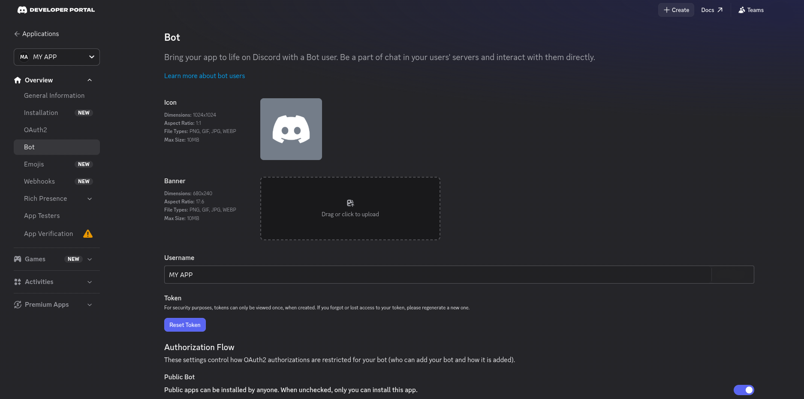
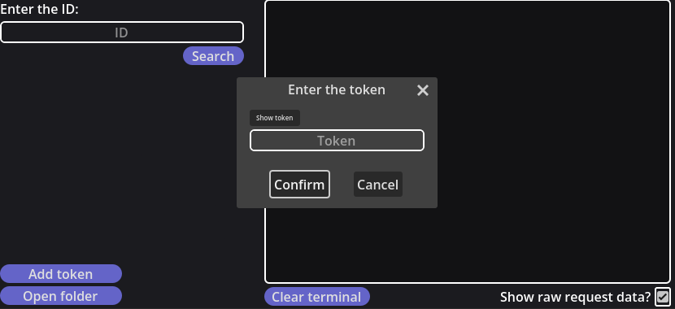
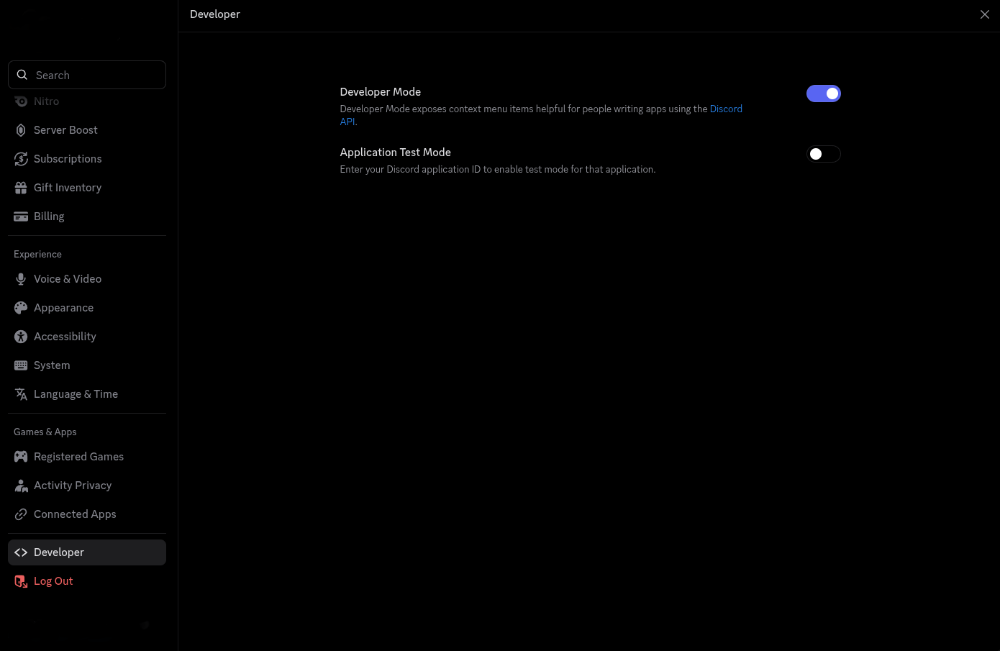
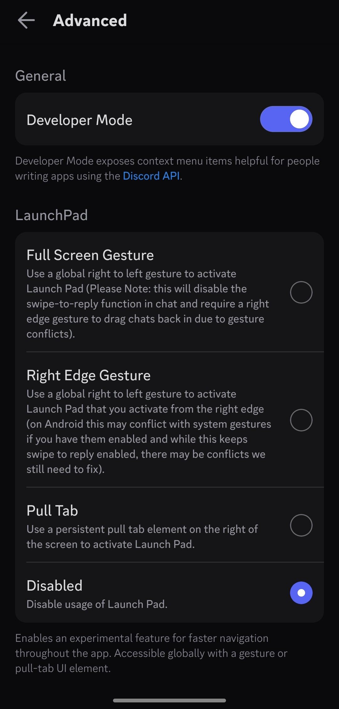
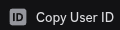
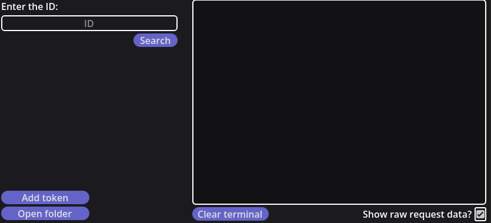

# Striker

An application that retrieves links for Discord banners and avatars.

# Important points!
- The application is not yet finished, but it is under active development. Therefore, some bugs may be encountered.

# LEGAL!

- Be very careful when accessing someone’s avatar/banner; we do not recommend doing so without that person’s consent.
- Striker uses only public API routes and official features offered to developers.
- Striker is intended for personal use; therefore, it does not support actions aimed at abusing Discord’s services.
-  **Striker is in NO way affiliated with Discord Inc., and is NOT endorsed by them!**

# How do I use it?

#### First, you need to obtain a Discord token.

- You can get one at:
	https://discord.com/developers/applications/

- Log in with your account and click "New application".
- After creating a bot, click on it and go to the 'BOT' tab.
- There, you can generate a new token by clicking "Reset Token"

#### Add it to Striker
- Click "Add Token," enter it in the popup that appears, and click "Confirm."

#### **Attention: take care of your token!** ⚠️
- Never use the token from your own account.
- Never share the token generated in the Discord portal with anyone.
- Do not use the token of a bot you are already using; create one specifically for Striker.
- Striker does not collect or share your token; it is stored exclusively on your computer.

#### After that, you need to enable developer mode in the Discord app to collect the IDs.

- You can do this by following the steps for each version of Discord:

   - Desktop: Settings -> Developer -> Developer Mode ✅

	

	- Mobile: Settings -> Advanced -> Developer Mode ✅
	
	
	
- You can copy a user's ID by following the steps for each version of Discord:

	- Desktop: Right-click on the user's mini-profile and select 'Copy user ID'

	- Mobile: Open the user's profile, tap the 3 dots in the corner, and select 'Copy user ID'

    

#### Ready!
- Once the token is configured, you can access and open the links for avatars and banners in your browser by left-clicking on the link that appears in the console after the search.
- Simply add the ID in the "Enter the ID" field and click "Search".

